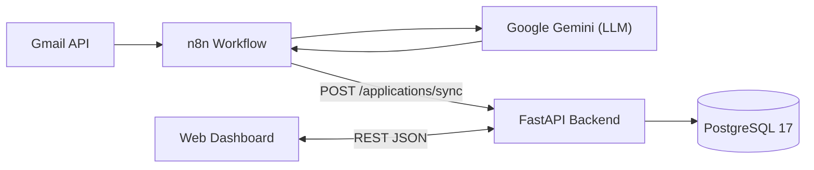

# AI Job Application Tracker

An intelligent, automated job application tracking system that detects recruitment emails from Gmail, classifies them with **Google Gemini** via **n8n**, stores structured records in **PostgreSQL** through a **FastAPI** backend, and displays pipeline analytics in a modern web dashboard.

---

## Architecture



---

## Key Features

- **Automated Email Ingestion**: Monitors incoming Gmail messages via n8n, filters out unrelated personal emails, and extracts recruitment updates automatically.
- **AI Classification (Google Gemini)**: Extracts the company name, role, summary, interview date/time, confidence score, and classifies emails into structured categories:
  - `APPLICATION_RECEIVED`
  - `INTERVIEW_INVITATION`
  - `INTERVIEW_CONFIRMED`
  - `REJECTION`
  - `OFFER_RECEIVED`
  - `OTHER` / `UNKNOWN`
- **Idempotent & Chronological Synchronization**:
  - Deduplicates applications using a normalized `application_key`.
  - Uses `last_email_at` timestamps so older emails never overwrite newer status updates.
- **Full CRUD REST API**: Built with FastAPI, SQLAlchemy 2.0, and Pydantic v2 validation.
- **Interactive Web Dashboard**: Clean vanilla HTML/CSS/JS interface with real-time search, status filtering, KPI cards, and modal forms for manual creation and editing.

---

## Tech Stack

| Layer | Technology |
|---|---|
| **Backend** | Python 3, FastAPI, Uvicorn |
| **Database** | PostgreSQL 17 (Docker Compose) |
| **ORM & Validation** | SQLAlchemy 2.0, Psycopg 3, Pydantic v2 |
| **Automation & AI** | n8n, Gmail API, Google Gemini (`gemini-3.1-flash-lite`) |
| **Frontend** | HTML5, CSS3, Vanilla JavaScript (ES6+) |

---

## Project Structure

```text
ai-job-application-tracker/
├── automation/                 # n8n workflow exports & automation assets
├── backend/
│   ├── app/
│   │   ├── api/
│   │   │   └── job_applications.py   # CRUD + /sync endpoints
│   │   ├── models/
│   │   │   └── job_application.py    # SQLAlchemy 2.0 model
│   │   ├── schemas/
│   │   │   └── job_application.py    # Pydantic v2 schemas
│   │   ├── database.py               # Engine & session management
│   │   └── main.py                   # FastAPI entrypoint & CORS
│   ├── create_tables.py              # Initial table creation script
│   └── requirements.txt              # Python dependencies
├── database/                   # Database utilities / notes
├── frontend/
│   ├── index.html              # Overview dashboard
│   ├── pages/
│   │   └── applications.html   # Applications management view
│   └── assets/
│       ├── css/style.css
│       └── js/
│           ├── api.js          # Fetch client
│           ├── dashboard.js    # Dashboard KPIs & recent list
│           └── applications.js # Search, filter & CRUD modal logic
├── docker-compose.yml          # PostgreSQL 17 service & persistent volume
├── .env.example                # Environment variable template
└── .gitignore
```

---

## Getting Started

### 1. Prerequisites
- **Docker Desktop**
- **Python 3.11+**
- **n8n** (optional, for automated Gmail synchronization)

### 2. Configure Environment Variables
Copy `.env.example` to `.env` in the project root and set your database credentials:

```powershell
Copy-Item .env.example .env
```

```env
POSTGRES_DB=job_tracker
POSTGRES_USER=job_tracker_user
POSTGRES_PASSWORD=your_secure_password
POSTGRES_HOST=127.0.0.1
POSTGRES_PORT=5434
```

### 3. Start PostgreSQL
From the project root:

```powershell
docker compose up -d
```

### 4. Set Up the Backend
```powershell
cd backend
python -m venv .venv
.\.venv\Scripts\Activate.ps1
pip install -r requirements.txt
python create_tables.py
uvicorn app.main:app --reload
```

- API base URL: `http://localhost:8000`
- Interactive Swagger docs: `http://localhost:8000/docs`

### 5. Launch the Frontend
Serve the `frontend/` directory on port `5500` (for example with the VS Code **Live Server** extension) and open:
- Dashboard: `http://localhost:5500/frontend/index.html` (or `http://localhost:5500/index.html` if `frontend/` is opened as root)

---

## API Endpoints

| Method | Endpoint | Description |
|---|---|---|
| `GET` | `/health` | Health check |
| `GET` | `/applications/` | List all job applications (newest first) |
| `GET` | `/applications/{id}` | Retrieve a single application by ID |
| `POST` | `/applications/` | Create a new application |
| `PATCH` | `/applications/{id}` | Partially update an application |
| `DELETE` | `/applications/{id}` | Delete an application |
| `POST` | `/applications/sync` | Idempotent upsert endpoint used by n8n |
