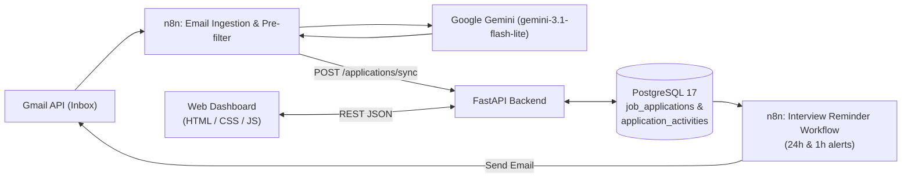

# AI Job Application Tracker

An intelligent, end-to-end job application tracking system that automatically detects recruitment emails from **Gmail**, classifies them using **Google Gemini** via **n8n**, stores structured records and chronological activity history in **PostgreSQL** through a **FastAPI** backend, sends automated **interview reminder emails**, and displays pipeline analytics in a modern web dashboard.

---

## System Architecture



---

## Key Features

### 1. Automated Email Ingestion & AI Classification
- **Two-Stage Filtering**: An n8n regex pre-filter discards newsletters, job alerts, and unrelated personal emails before invoking the LLM.
- **Structured Extraction with Google Gemini (`gemini-3.1-flash-lite`)**:
  - Extracts `company`, `position`, `summary`, `interview_date` (`YYYY-MM-DD`), `interview_time` (`HH:mm`), and `confidence` (`0–1`).
  - Classifies each email into structured categories:
    - `APPLICATION_RECEIVED` → `PENDING`
    - `INTERVIEW_INVITATION` → `INTERVIEW`
    - `INTERVIEW_CONFIRMED` → `INTERVIEW` / `INTERVIEW_CONFIRMED`
    - `REJECTION` → `REJECTED`
    - `OFFER_RECEIVED` → `OFFER_RECEIVED`
    - `OTHER` / `UNKNOWN` (filtered out from database synchronization)

### 2. Concurrency-Safe & Chronological Synchronization
- **Deduplication**: Normalizes `company` + `position` into a unique `application_key`.
- **Race-Condition Protection**: Uses PostgreSQL row-level locking (`SELECT ... FOR UPDATE`) and `SAVEPOINT` recovery (`db.begin_nested()`) so simultaneous n8n requests for the same application never fail with `409 Conflict` or create duplicates.
- **Chronological Ordering**: Compares `last_email_at` timestamps so an older `PENDING` confirmation email never overwrites a newer `INTERVIEW` or `OFFER_RECEIVED` status.

### 3. Application Activity History & Details Modal
- **Automatic Audit Trail (`application_activities`)**: Tracks application creation, status transitions, interview date/time scheduling and updates, and synchronization events with timestamps.
- **Interactive Details Modal**: Clicking **View Details** on any application opens a modal showing the full summary, AI confidence score, interview schedule, classification metadata, and a chronological activity timeline.

### 4. Automated Interview Reminders
- A dedicated n8n workflow (`Interview Reminder Notifications.json`) queries upcoming interviews in `Europe/Berlin` time and sends automatic email reminders **24 hours** and **1 hour** before the scheduled interview, recording sent alerts in `interview_reminders` to prevent duplicate notifications.

### 5. Modern SaaS Dashboard
- **5 KPI Cards**: *Total applications*, *Pending*, *Interviews*, *Offers*, and *Rejections*.
- **7-Column Pipeline Table**: *Company*, *Position*, *Status*, *Interview Date* (`Nov 12, 2026`), *Interview Time* (`10:30`), *Last Updated*, and *Actions* (`View Details`, `Edit`, `Delete`).
- Real-time search across company, position, and summary, plus status filtering and modal forms for manual creation and editing.

---

## Tech Stack

| Layer | Technology |
|---|---|
| **Backend** | Python 3, FastAPI, Uvicorn |
| **Database** | PostgreSQL 17 (Docker Compose) |
| **ORM & Migrations** | SQLAlchemy 2.0, Psycopg 3, Alembic, Pydantic v2 |
| **Automation & AI** | n8n, Gmail API, Google Gemini (`models/gemini-3.1-flash-lite`) |
| **Frontend** | HTML5, CSS3, Vanilla JavaScript (ES6+) |
| **Testing** | Pytest, FastAPI `TestClient` |

---

## Project Structure

```text
ai-job-application-tracker/
├── automation/
│   ├── AI Job Application Tracker.json          # n8n Gmail -> Gemini -> FastAPI workflow
│   └── Interview Reminder Notifications.json    # n8n 24h & 1h interview reminder workflow
├── backend/
│   ├── alembic/
│   │   ├── env.py
│   │   └── versions/
│   │       └── a1c9f4e82b01_create_application_activities.py
│   ├── app/
│   │   ├── api/
│   │   │   └── job_applications.py              # CRUD, /sync, and /activities endpoints
│   │   ├── models/
│   │   │   ├── job_application.py               # JobApplication SQLAlchemy model
│   │   │   └── application_activity.py          # ApplicationActivity timeline model
│   │   ├── schemas/
│   │   │   └── job_application.py               # Pydantic v2 schemas & date/time normalizers
│   │   ├── database.py                          # Engine & session management
│   │   └── main.py                              # FastAPI entrypoint, lifespan & CORS
│   ├── tests/
│   │   └── test_dashboard_upgrade.py            # Automated CRUD, chronology & concurrency tests
│   ├── alembic.ini
│   ├── create_tables.py
│   └── requirements.txt
├── database/
├── frontend/
│   ├── index.html                               # Overview dashboard (KPIs + recent applications)
│   ├── pages/
│   │   └── applications.html                    # Full applications tracker + modals
│   └── assets/
│       ├── css/style.css                        # Responsive styling & modal/timeline design
│       └── js/
│           ├── api.js                           # REST client, date/time formatters & modal logic
│           ├── dashboard.js                     # Overview dashboard controller
│           └── applications.js                  # Search, filter, CRUD & details controller
├── docker-compose.yml                           # PostgreSQL 17 service & persistent volume
├── .env.example                                 # Environment variable template
├── .gitignore
└── README.md
```

---

## Getting Started

### 1. Prerequisites
- **Docker Desktop**
- **Python 3.11+**
- **n8n** (optional, for automated Gmail ingestion and interview reminders)

### 2. Configure Environment Variables
Copy `.env.example` to `.env` in the project root and set your PostgreSQL credentials:

```powershell
Copy-Item .env.example .env
```

```env
POSTGRES_DB=job_tracker
POSTGRES_USER=job_tracker_user
POSTGRES_PASSWORD=your_secure_password
POSTGRES_HOST=127.0.0.1
POSTGRES_PORT=5434
```

### 3. Start PostgreSQL
From the project root:

```powershell
docker compose up -d
```

### 4. Set Up the Backend & Run Migrations
```powershell
cd backend
python -m venv .venv
.\.venv\Scripts\Activate.ps1
pip install -r requirements.txt
python -m alembic upgrade head
uvicorn app.main:app --reload
```

- API base URL: `http://localhost:8000`
- Interactive Swagger UI: `http://localhost:8000/docs`

### 5. Launch the Frontend
Serve the project with the VS Code **Live Server** extension on port `5500` and open:
- **Dashboard**: `http://localhost:5500/frontend/index.html`
- **Applications View**: `http://localhost:5500/frontend/pages/applications.html`

### 6. Import n8n Workflows (Optional)
Import the JSON files from `automation/` into your n8n instance:
1. `automation/AI Job Application Tracker.json` — Connects Gmail Trigger, Gemini (`models/gemini-3.1-flash-lite`), and `POST http://host.docker.internal:8000/applications/sync`.
2. `automation/Interview Reminder Notifications.json` — Connects Schedule Trigger, PostgreSQL, and Gmail to send 24h and 1h interview reminders.

---

## API Endpoints

| Method | Endpoint | Description |
|---|---|---|
| `GET` | `/health` | Service health check |
| `GET` | `/applications/` | List all job applications with their activity history (newest first) |
| `GET` | `/applications/{id}` | Retrieve a single application and its chronological activity history |
| `GET` | `/applications/{id}/activities` | List chronological activity events for an application |
| `POST` | `/applications/` | Create a new application and record its initial activity event |
| `PATCH` | `/applications/{id}` | Partially update an application and log status/schedule changes |
| `DELETE` | `/applications/{id}` | Delete an application and cascade-delete its activity history |
| `POST` | `/applications/sync` | Concurrency-safe, chronological upsert endpoint used by n8n |

---

## Running Tests

From the `backend/` directory with the virtual environment activated:

```powershell
python -m pytest -v tests/test_dashboard_upgrade.py
```
